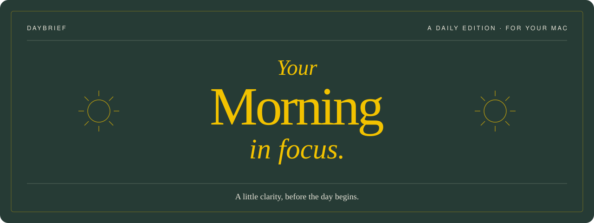
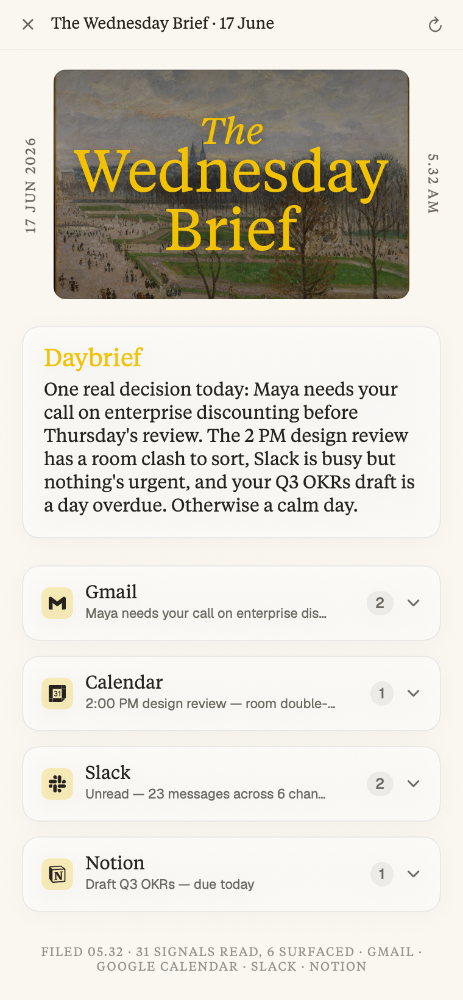
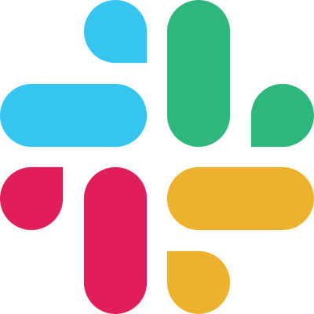
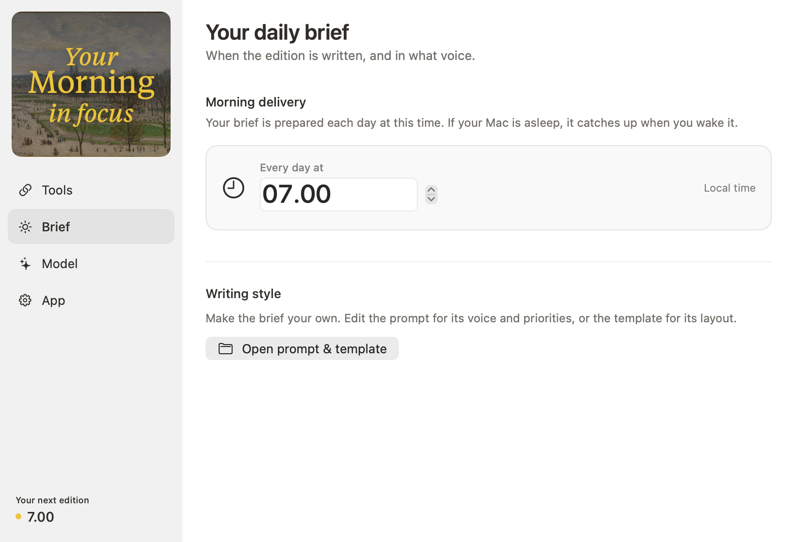
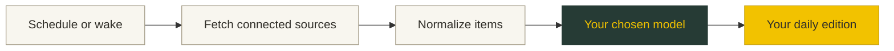

<p align="center">
  
</p>

<p align="center">
  <strong>Your calendar, inbox, conversations, and tasks. One thoughtful morning brief.</strong><br>
  Native to your Mac. Written by your chosen AI model. Ready in your menu bar.
</p>

<p align="center">
  <a href="https://github.com/apyfz/daybrief/releases/tag/v0.1.0">Download</a> ·
  <a href="#the-morning-edition">Take a look</a> ·
  <a href="#get-started">Get started</a> ·
  <a href="#your-tools-your-model">Connections</a> ·
  <a href="#where-your-data-goes">Privacy</a> ·
  <a href="CONTRIBUTING.md">Contribute</a>
</p>

<p align="center"><sub>macOS 26+ · Swift 6.2 · Apple Silicon · v0.1.0 · AGPL-3.0-only</sub></p>

---

## The morning edition

Daybrief gathers the things worth knowing and turns them into a small daily periodical: a painting, a golden masthead, a short overview, and the details that deserve your attention. Open a source when you want more context; follow an item back to the tool it came from.

<p align="center">
  
  <br><sub>Rendered from the app’s UI with fictional sample content. Artwork: Camille Pissarro, public domain.</sub>
</p>

| A calmer start | Made for your Mac | Yours to shape |
| :--- | :--- | :--- |
| A concise overview followed by source-by-source details. Quiet days stay quiet. | A menu-bar app, a daily delivery time, and catch-up when your Mac wakes. | Choose your AI provider, pick Slack channels, and edit the writing prompt and template. |

## Your tools, your model

Connect only the sources you want in your edition.

| Tool | What it brings |
| :--- | :--- |
|  **Google Calendar** | Today and tomorrow’s events. |
|  **Gmail** | Unread and important mail, with support for multiple accounts. |
|  **Slack** | Direct messages, mentions, and unread messages from channels you select. |
| **Notion** | Tasks due today or overdue in the databases you share. |

Bring a key for **OpenRouter, OpenAI, Anthropic, or Gemini**, or use **Ollama** for local inference. You can change your provider and model in Settings.

<details>
<summary><strong>A look inside Settings</strong></summary>
<br>

<br>
<sub>Rendered with sample settings; native controls appear in the running app.</sub>
</details>

## Get started

Download **[Daybrief v0.1.0](https://github.com/apyfz/daybrief/releases/tag/v0.1.0)** for Apple Silicon and macOS 26+. Unzip the download and move Daybrief.app to Applications. This build is not notarized; see the release notes for installation details. The desktop widget is not included in this download.

### Build from source

Use **macOS 26, Xcode 26, and Swift 6.2** on Apple Silicon.

```sh
git clone https://github.com/apyfz/daybrief.git
cd daybrief

brew install xcodegen
xcodegen generate
open Daybrief.xcodeproj
```

Select the **Daybrief** scheme in Xcode, configure signing for your Mac, and run. The app lives in the **menu bar**, without a Dock icon.

1. **Choose a model.** Add your provider’s API key, or configure Ollama locally.
2. **Connect your tools.** The app walks you through the credentials and permissions for each service. You can skip sources and add them later.
3. **Set your delivery time.** Your edition is prepared daily; if your Mac is asleep, it catches up when you wake it.

For repeat local development with an Apple Development signing identity, use `./scripts/dev-run.sh`.

### Connection guides

Daybrief connects directly to services using credentials you provide. Setup takes a little more work, but there is no Daybrief account or intermediary server.

- **[Google Calendar & Gmail](docs/onboarding/google.md)** — create a Google Desktop OAuth client.
- **[Slack](docs/onboarding/slack.md)** — create an internal Slack app and supply its user token.
- **Notion** — follow the in-app guide to create an integration and share your task databases.
- **[OpenRouter](docs/onboarding/openrouter.md)** — add a key and choose a model.

## Where your data goes

**There is no Daybrief server.** The app reads directly from the services you connect. Tokens and API keys are stored in the macOS Keychain.

When you use a **cloud AI model**, the content needed to write your brief is sent to that provider under your account. With **local Ollama**, synthesis stays on your Mac; connected services still require network access.

The default database is local SQLite. SQLCipher encryption requires a [separate build configuration](docs/build/grdb-sqlcipher.md). The desktop widget uses a local, plaintext snapshot of the brief. See [the security notes](SECURITY.md) for storage details and the full data flow.

## Under the hood



A thin SwiftUI app sits over local Swift packages. Connectors fetch concurrently with individual timeouts; a failed source produces a partial edition with the failure surfaced.

<details>
<summary><strong>Package map</strong></summary>

| Package | Responsibility |
| :--- | :--- |
| `DaybriefCore` | Shared domain types and transport interfaces. |
| `ConnectorKit` + connector packages | OAuth and source-specific fetching and normalization. |
| `LLMKit` | Provider adapters, structured output, validation and repair. |
| `Pipeline` | Fetching, synthesis, artwork selection and scheduling. |
| `BriefRender` | HTML, Markdown and presentation models. |
| `Secrets` / `Persistence` | Keychain storage and SQLite through GRDB. |
| `AppFeature` / `DaybriefUI` | App state, settings, onboarding and shared visual components. |
| `DaybriefWidgetUI` | Desktop widget layouts. |

</details>

```sh
swift build
swift test

xcodebuild -project Daybrief.xcodeproj \
  -scheme Daybrief -configuration Debug -destination 'platform=macOS' build
```

The editorial typeface uses Tiempos Text when separately licensed and installed; otherwise it falls back to a system serif. Font files are not distributed in this repository. See [font setup](Sources/DaybriefUI/Fonts/README.md) and [artwork notes](App/Assets.xcassets/Art/README.md).

---

<p align="center">
  <strong>Make mornings a little clearer.</strong><br>
  <a href="CONTRIBUTING.md">Contributing</a> · <a href="CLA.md">Contributor agreement</a> · <a href="LICENSE">AGPL-3.0-only</a> · <a href="SECURITY.md">Security</a>
</p>
