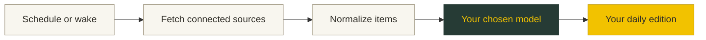

# Developing Daybrief

Run commands from the repository root.

### Build from source

Use **macOS 26, Xcode 26, and Swift 6.2** on Apple Silicon.

```sh
git clone https://github.com/apyfz/daybrief.git
cd daybrief

brew install xcodegen
xcodegen generate
open Daybrief.xcodeproj
```

Select the **Daybrief** scheme in Xcode, configure signing for your Mac, and run. The app lives in the **menu bar**, without a Dock icon.


## Under the hood



A thin SwiftUI app sits over local Swift packages. Connectors fetch concurrently with individual timeouts; a failed source produces a partial edition with the failure surfaced.

<details>
<summary><strong>Package map</strong></summary>

| Package | Responsibility |
| :--- | :--- |
| `DaybriefCore` | Shared domain types and transport interfaces. |
| `ConnectorKit` + connector packages | OAuth and source-specific fetching and normalization. |
| `LLMKit` | Provider adapters, structured output, validation and repair. |
| `Pipeline` | Fetching, synthesis, artwork selection and scheduling. |
| `BriefRender` | HTML, Markdown and presentation models. |
| `Secrets` / `Persistence` | Keychain storage and SQLite through GRDB. |
| `AppFeature` / `DaybriefUI` | App state, settings, onboarding and shared visual components. |
| `DaybriefWidgetUI` | Desktop widget layouts. |

</details>

```sh
swift build
swift test

xcodebuild -project Daybrief.xcodeproj \
  -scheme Daybrief -configuration Debug -destination 'platform=macOS' build
```

The editorial typeface uses Tiempos Text when separately licensed and installed; otherwise it falls back to a system serif. Font files are not distributed in this repository. See [font setup](../../Sources/DaybriefUI/Fonts/README.md) and [artwork notes](../../App/Assets.xcassets/Art/README.md).

